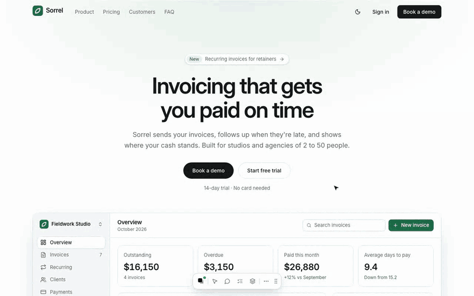
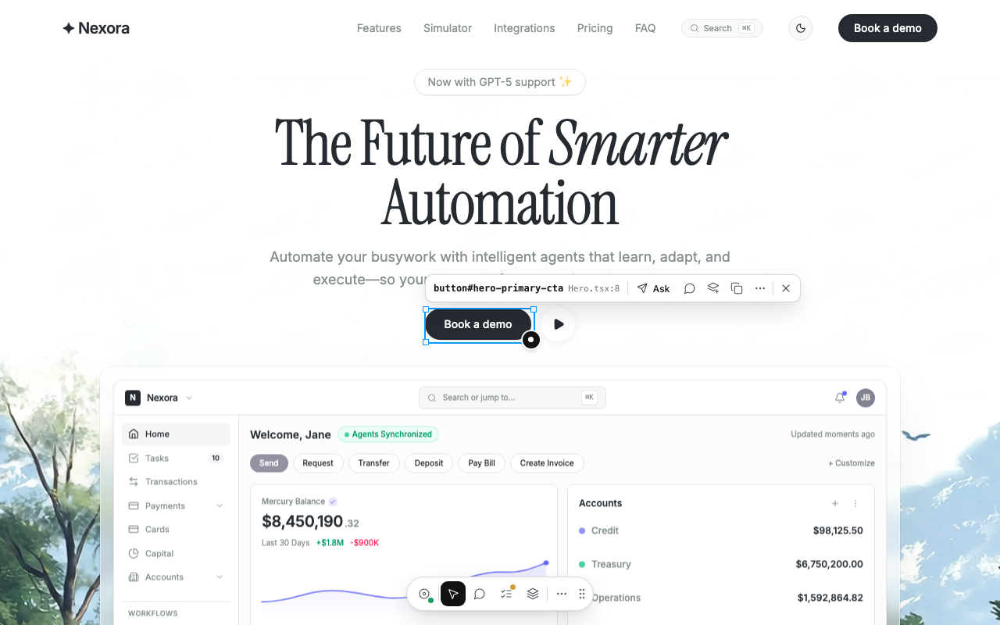
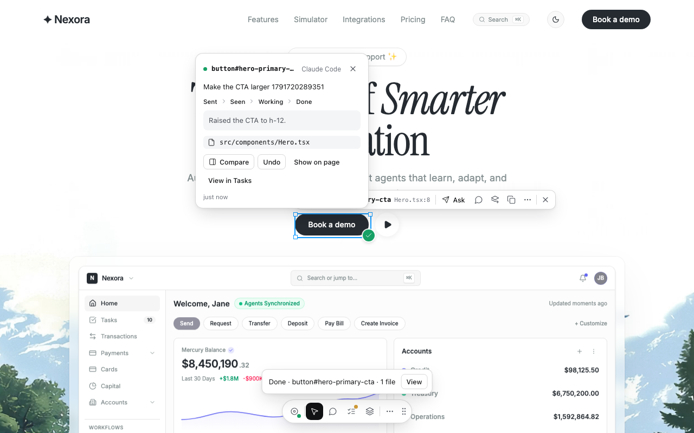
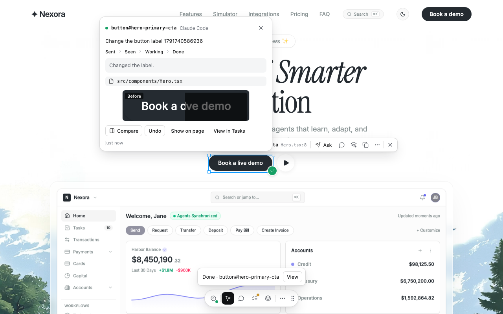
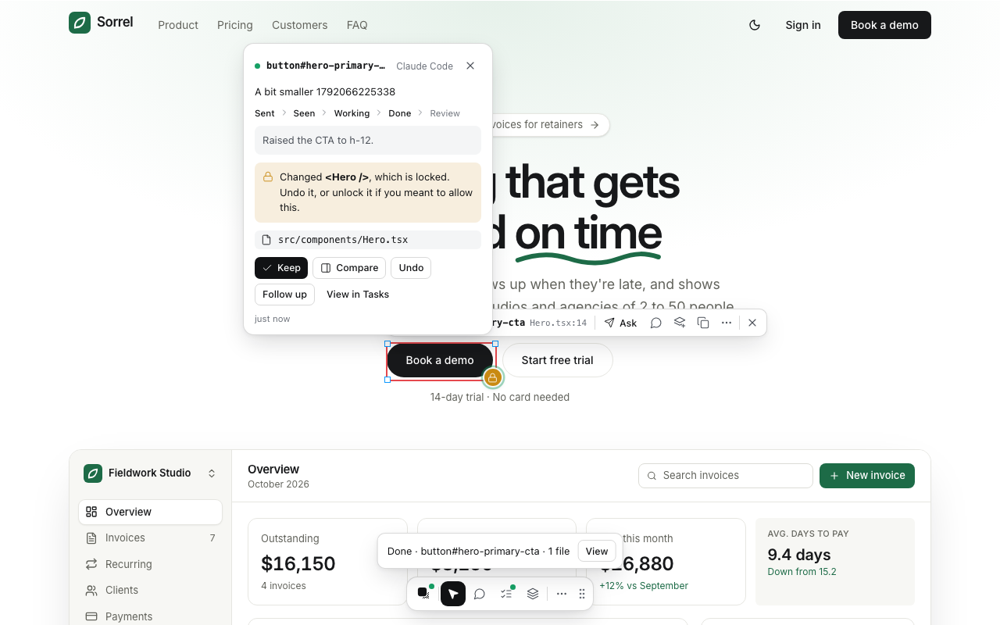

<p align="center">
  <picture>
    <source media="(prefers-color-scheme: dark)" srcset="docs/brand/logo/mark-light.svg">
    
  </picture>
</p>

# Agent Hover

[](https://www.npmjs.com/package/@agent-hover/vite)
[](https://github.com/amrnadh/agent-hover/actions/workflows/ci.yml)
[](LICENSE)

**See every UI change your agent makes, right on the page. Keep it or undo it.**

Ask for a change on any element of your running React app. Your coding agent gets the exact file, the line that renders it, how it looks now and what it must not touch. While it works, the task stays on the element: Sent, Seen, Working, Done. Then you review it there: compare before and after, keep it, undo it in one click, or follow up. Lock what's finished, and Agent Hover tells you if an agent changed it anyway.

Works with Claude Code, Cursor, Codex and any other MCP agent, or with plain Copy for ChatGPT, Claude.ai, v0, Lovable and Bolt.



**[Watch the full demo (1:36)](docs/media/agent-hover-demo.mp4)**: point instead of describe, "like this, not that", notes, adding a feature, and keeping agents off finished work.

## Quick start

In your Vite + React project:

```bash
npx agent-hover init
```

It installs `@agent-hover/vite`, adds it to your Vite config, connects your agent (MCP config and a short rules note), and keeps local data out of git. It shows every change and asks first; `--dry-run` only shows them.

Then:

1. Start your dev server (`npm run dev`) and open the app.
2. Press **Alt** (or the pointer in the dock) and click anything.
3. Press **Ask**, type what to change, press **⌘/Ctrl + Enter**.
4. Run **`/agent-hover`** in your agent (**`$agent-hover`** in Codex), or tell it **"Listen for agent-hover tasks."** It picks up each task you send, does it, reports back, and waits for the next one. **`/agent-hover-status`** shows what is waiting.

Something not working? `npx agent-hover doctor` checks the plugin, the dev server, the token and the agent connection, and tells you what to fix.

<details>
<summary>Manual setup</summary>

```bash
npm install -D @agent-hover/vite
```

```ts
// vite.config.ts
import { defineConfig } from 'vite';
import react from '@vitejs/plugin-react';
import agentHover from '@agent-hover/vite';

export default defineConfig({
  plugins: [react(), agentHover()],
});
```

Register the MCP server with your agent. For Claude Code:

```bash
claude mcp add agent-hover -- npx -y @agent-hover/mcp
```

`npx agent-hover mcp <agent>` prints the config for `cursor`, `codex`, `opencode`, `windsurf`, `antigravity` and `claude-desktop`.
</details>

## How it works

**Ask.** Press **Alt** (or the pointer in the dock) and click an element. A small pill offers Ask, Comment, add to Batch, Copy, and more (open in editor, screenshot, lock from agents, parent/child, details). Describe the change (or click the mic and say it); it goes to your connected agent, or to the clipboard when none is connected (or when you prefer Copy). With several agents connected, pick which one gets it.



**Track.** A marker on the element follows the task: Sent → Seen → Working → Done. Open it for the agent's summary and the files it changed. Markers come back after a reload.



**Review.** A finished change waits on its element until you decide. **Compare** shows the element before and after. **Keep** settles it. **Undo** restores exactly the files that changed, after showing you the list: when the agent picks up a task, Agent Hover takes a git checkpoint of your work tree (including uncommitted and untracked files, without touching them). **Follow up** asks again about the same element, and the new prompt carries the earlier request and what the agent did, so it builds on the change instead of starting over.



**Lock.** "Don't let agents change this" on a component puts it in every prompt as off limits. If a finished task changed its file anyway, its marker turns amber and the card says which locked component changed, with Undo right there.



**Comment and Batch.** Press **C** to drop numbered notes anywhere and send them one at a time or all at once. Press **B** (or click elements while the Batch tab is open) to collect several elements into one task, each marked Change, Reference or Don't touch ("make these three cards consistent").

**Inspect.** The sidebar shows the component, a clickable breadcrumb, live props (secrets redacted), hooks, text, box model and key styles, and the source, with the token count of what would be sent.

## What your agent receives

A short, ordered brief instead of a vague description. Real output for "Make this button larger with a subtle arrow icon":

```md
# Change request: <button> “Book a demo” in <Hero />

## What to do
Make this button larger with a subtle arrow icon

## Where
- Element: `button#hero-primary-cta` with text “Book a demo”
- Rendered by: `<Hero />` in `src/components/Hero.tsx`, lines 14–80
- In the source, the element is around line 55
- It is rendered through `<Button>` (line 54), a shared component: change this usage
  (className or props) rather than `<Button>` itself, unless the request is about every Button.

## The element now
- Rendered: 135×44px · font 14px/500 · color #ffffff on #17181a · padding 0px 24px · radius full · flex row, gap 8px

## Constraints
- Change this element only; keep the rest of <Hero /> as it is.
- Follow the existing styling approach (Tailwind utility classes in this file).

## Source: src/components/Hero.tsx (lines 14–80)
…
```

Long components send only the ~90 lines around the element by default (Settings › Context detail: Compact, Standard or Deep).

## Works with

| Tool | How |
|------|-----|
| Claude Code | MCP, project `.mcp.json` (set up by `init`) |
| Cursor | MCP, project `.cursor/mcp.json` (set up by `init`) |
| Codex | MCP, project `.codex/config.toml` (set up by `init`) |
| OpenCode | MCP, project `opencode.json` (set up by `init`) |
| Windsurf, Antigravity, Claude Desktop | MCP, global config (`npx agent-hover mcp <agent>` prints it) |
| ChatGPT, Claude.ai, v0, Lovable, Bolt, anything else | Copy: every prompt is self-contained |

## Keyboard

| Key | Action |
|-----|--------|
| Alt | Inspect on / off |
| Enter | Ask about the selection |
| C | Comment mode (or comment on the selection) |
| B | Add the selection to the batch |
| ⌘/Ctrl + C | Copy the selection's context |
| O | Open in your editor |
| ↑ / ↓ | Select parent / child |
| Hold ⌘/Ctrl | Show distances |
| Hold Shift | Click through to the page |
| T | Tasks |
| ⌘/Ctrl + Shift + X | Hide / show the dock |
| Esc | Close the innermost thing |

Letter shortcuts only work while Agent Hover is in use, so they never take over your app's own shortcuts.

## Requirements

- Node 20 or newer, Vite 5 or newer (tested up to Vite 8), React 18 or 19.
- macOS, Linux and Windows 10/11.
- Chrome, Edge, Firefox and Safari.
- Dev only: the plugin runs with `vite dev` and adds nothing to production builds.
- Compare and Undo need a git repository; everything else works without one.
- Next.js support is next on the roadmap.

## Privacy and security

- Everything runs on your machine. The bridge listens on `127.0.0.1` only, checks the page's origin, and requires a per-session token (stored in `.agent-hover/session.json`, which `init` adds to `.gitignore`).
- No telemetry. The only outbound request is a once-a-day update check to the npm registry, with no project data; turn it off with `AGENT_HOVER_NO_UPDATE_CHECK=1` (or the usual `NO_UPDATE_NOTIFIER=1`).
- Voice uses your browser's speech recognition: on the device when the browser can, otherwise Chrome and Edge send the audio to Google or Microsoft and Safari to Apple (you are told once, before the first use). Agent Hover never receives or stores audio. Turn the mic off in Settings › Voice.
- Undo never runs `git reset`, `clean` or `checkout`; it restores the listed files one by one from the checkpoint.

Details: [SECURITY.md](SECURITY.md) and the [bridge API](docs/bridge-api.md).

## Packages

| Package | |
|---------|--|
| [`agent-hover`](packages/cli) | `npx agent-hover`: init, doctor, MCP config per agent |
| [`@agent-hover/vite`](packages/vite) | Vite plugin and local bridge (task queue, checkpoints) |
| [`@agent-hover/mcp`](packages/mcp) | MCP server your agent talks to |
| [`@agent-hover/overlay`](packages/overlay) | The in-page UI (shadow DOM) |
| [`@agent-hover/core`](packages/core) | Context engine: source parsing, prompt formatting, token counts |

## Contributing

See [CONTRIBUTING.md](CONTRIBUTING.md). Changes are listed in the [CHANGELOG](CHANGELOG.md).

## License

MIT
